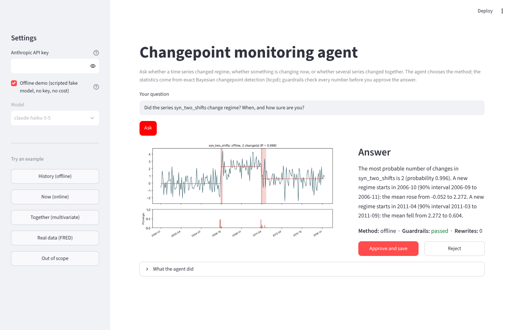

# bcpd-agent

A monitoring-analyst agent that answers questions like *"Did this series change regime, when, and how sure are you?"*, *"Is something changing right now?"* and *"Did these series change together?"*. It chooses the right Bayesian changepoint method for each question from [bcpd](https://github.com/NastaranM/bcpd-repo), and it's wrapped in guardrails, an audit log and an evaluation suite that measure whether it can be trusted.

```
question ─► scope guardrail ─► Claude ─ chooses a method ─► offline · online · multivariate (bcpd)
                                  │
                                  ▼
             grounding + direction guardrails ─► human approval ─► report + audit log
```



## Why

LLMs are good at explaining and choosing, and bad at arithmetic. So this agent never does statistics itself. It decides which method fits the question, then reports only what the tools computed. Deterministic checks reject any number or date that no tool produced, and any "rose" or "fell" that contradicts the computed change. The same control pattern applies to any model-monitoring workflow in a regulated setting.

## Three methods, one decision

| Question | Tool | Method |
|---|---|---|
| "Did it change, and when?" | `detect_changepoints` | Exact offline inference over all segmentations |
| "Is something changing now?" | `detect_recent_change` | Online particle filter: when did the current regime start? |
| "Did these change together?" | `detect_joint_changepoints` | Multivariate model: finds shared changes no single series shows |

The evaluation checks that the agent picks the right one.

## What's inside

| Part | File | What it does |
|---|---|---|
| Tools | `src/bcpd_agent/tools.py` | Load data (FRED or built-in test series), the three detection methods, plot |
| Agent loop | `src/bcpd_agent/agent.py` | Hand-written tool-calling loop with step limits, token and latency logging |
| Guardrails | `src/bcpd_agent/guardrails.py` | Scope check, grounding check (numbers and dates), direction check, structured verdict, human approval |
| Audit log | `src/bcpd_agent/audit.py` | One JSON record per question: tools, inputs, outputs, guardrail results, approval |
| Interface | `app.py`, `src/bcpd_agent/plots.py` | Streamlit page: question, chart drawn from the tool output, answer, agent trace, Approve / Reject |
| Evaluation | `evals/` | 18 cases with known truth: planted changes, recent vs old changes, a joint change, missing data, out-of-scope questions |
| Tests | `tests/` | 23 tests that run offline with a scripted fake model, so no API key is needed |

## Evaluation design

Each answer is scored on separate questions, so an error can be traced to where it came from:

- **Method choice:** did the agent pick offline, online or multivariate correctly?
- **Detector accuracy:** did the statistics find the planted change? (tool vs truth)
- **Faithfulness:** did the agent report what the tool said? (answer vs tool)
- **End-to-end accuracy:** is the final answer right? (answer vs truth)

It also measures 90% interval coverage (calibration), refusal accuracy, fabrication on missing data, unsupported numbers and wrong-direction wording before and after the guardrails, latency and tokens. In CI, any guardrail failure that reaches a final answer fails the build.

## Results (28 October 2026, 18 cases)

| Metric | Haiku 5.5 | Sonnet 5.5 |
|---|---|---|
| Method choice accuracy | 1.00 | 1.00 |
| Faithfulness (answer matches tool) | 1.00 | 1.00 |
| Refusal accuracy (incl. 2 paraphrases the regex misses) | 1.00 | 1.00 |
| No fabrication on a missing series | 1.00 | 1.00 |
| End-to-end accuracy | 0.83 | 0.83 |
| Detector accuracy (±3 months) | 0.83 | 0.83 |
| 90% interval coverage | 0.91 | 0.91 |
| Unsupported numbers: first draft / final | 0.06 / 0.00 | 0.06 / 0.00 |
| Wrong-direction wording: first draft / final | 0.00 / 0.00 | 0.00 / 0.00 |
| Mean latency | 3.5 s | 4.4 s |
| Tokens per run (in / out) | 90,585 / 5,937 | 92,315 / 5,047 |
| Approximate cost per run | ~$0.01 | ~$0.23 |

**Findings**

- **The small model is enough here.** Haiku matched Sonnet on every quality and safety metric, at about a twentieth of the cost and lower latency. When the statistics is done by deterministic tools and the answer is checked by guardrails, the model's job is choosing and explaining, and a small model does that well.
- **Every end-to-end miss traces to the statistics, not the LLM.** The two misses (`two_shifts`, `three_shifts`) have faithfulness 1.0: the agent reported the tool exactly, and the detector placed some dates 4–5 months from the truth. Repeating those designs with 200 noise draws gives an average date error of +0.01 months (no bias), and the true date falls inside the 90% interval 95% of the time. The stated uncertainty is honest.
- **The evaluation found two false alarms in the grounding guardrail, not hallucinations.** In the first runs, both models' only first-draft flag was the same case: refusing *"where is the series heading over the coming 12 months"* while repeating "12" from the question. In a later run, a correct *"change of −1.668"* was flagged because the model used a typographic minus sign (−) that the check read as a positive number. Numbers from the user's question now count as supported, typographic minus signs are normalised, and each fix has a regression test. A wrong sign is still caught. In every case the final answer was clean. The evaluation tests the controls as well as the model.

## Quick start

**1. Get the code and install**

```bash
git clone https://github.com/NastaranM/bcpd-agent.git
cd bcpd-agent
python -m venv .venv && source .venv/bin/activate      # Windows Git Bash: source .venv/Scripts/activate
pip install -e ".[dev,ui]"
```

The extras are optional:

| Install | You get |
|---|---|
| `pip install -e .` | The agent and the `bcpd-agent` command |
| `pip install -e ".[dev]"` | + pytest, to run the tests |
| `pip install -e ".[ui]"` | + Streamlit, for the web interface |

**2. Check it works offline (no API key, no cost)**

```bash
pytest
python -m evals.run_eval --fake
```

**3. Web interface**

```bash
streamlit run app.py
```

It opens in your browser. Without an API key it starts in offline demo mode with a scripted model; with a key it uses Claude. Stop it with Ctrl+C.

**4. Command line and evaluation with the real model**

```bash
export ANTHROPIC_API_KEY=...
bcpd-agent "Did the series syn_two_shifts change regime? When?"
bcpd-agent "Is something changing right now in syn_recent_change?"
bcpd-agent "Did syn_mv_1, syn_mv_2, syn_mv_3 and syn_mv_4 change together?"
bcpd-agent "Did the US credit card charge-off rate (CORCCACBS) change regime since 2000?"
python -m evals.run_eval                                # real evaluation
python -m evals.run_eval --model claude-sonnet-5-5      # compare models
```

## Limitations

- The scope guardrail uses keyword patterns, so paraphrases can slip past. The model's own refusal is the second layer, and the evaluation includes paraphrased cases to measure both.
- The grounding check verifies that numbers and dates come from tools. A date that appears anywhere in a tool output, such as an interval endpoint, passes even if used in the wrong place.
- The direction check is rule-based. It only judges sentences that mention exactly one change date with unambiguous rise or fall words, so it avoids false alarms but can miss errors. An LLM-as-a-judge would be the next step.
- The online tool's segment-length prior (a quarter of the series on average) is an assumption. The agent analyses level changes in seasonally adjusted series; seasonal series are out of scope.
- The evaluation set is small (18 cases), so treat the rates as indicative.

MIT licence. Built with assistance from Claude (Anthropic).
